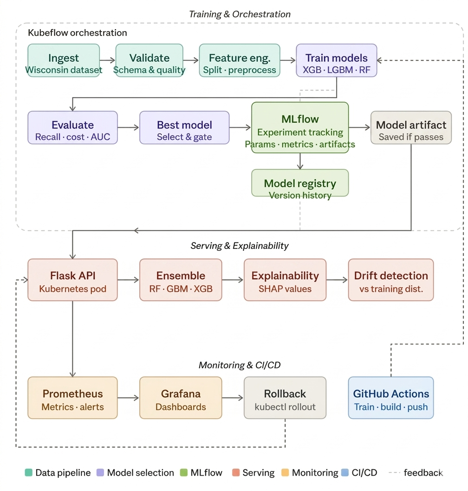

# Breast Cancer MLOps Pipeline

This project demonstrates how a machine-learning model can move from data and training to an API that serves predictions. It uses scikit-learn's Breast Cancer Wisconsin dataset to classify tumors as malignant (`0`) or benign (`1`).

**Repository owner:** [Ayush-Singh986](https://github.com/Ayush-Singh986)

## Architecture



## Project walkthrough

### Runnable local workflow

1. **Load the data** — `model/train.py` loads the breast-cancer dataset directly from scikit-learn. Each record has 30 numeric measurements and a binary target.
2. **Split into train and test sets** — The script uses an 80/20 split with a fixed random seed, making the experiment repeatable.
3. **Train candidate models** — It fits Random Forest, Logistic Regression, and XGBoost classifiers using the same training data.
4. **Evaluate and track experiments** — For each model, it calculates accuracy, precision, recall, and F1 score on the test set. MLflow records these metrics, the model name, and the trained model artifact in `model/mlruns`.
5. **Choose and save a model** — The script selects the model with the highest test accuracy and saves it to `model/model.pkl`.
6. **Serve predictions** — `model/predict.py` loads that saved model when the API starts. A client sends 30 measurements and an API key to `POST /predict`; the API returns the predicted class. Health endpoints are available separately and do not require authentication.

### Extended Kubeflow workflow

`model/kubeflow_code.py` describes a separate, more detailed pipeline intended to run in Kubeflow Pipelines:

1. **Ingest and validate** — Load the dataset and check that it is non-empty, contains a target column, and has both classes.
2. **Engineer features** — Add a small set of statistical and ratio-based features.
3. **Split and preprocess** — Make stratified training, calibration, and test splits (60/20/20). Fit preprocessing on the training data and apply it to the other splits.
4. **Train five candidates** — Compare standard XGBoost, cost-sensitive XGBoost, XGBoost with SMOTE, cost-sensitive LightGBM, and a feature-selected Random Forest.
5. **Evaluate and select** — Calculate classification metrics, AUC-ROC, false positives/negatives, and business cost. Select by highest recall, then lowest business cost, then highest AUC-ROC.
6. **Calibrate predictions** — Use the calibration split for conformal calibration, then evaluate prediction-set coverage and size on the test split.
7. **Apply deployment gates** — Continue only when recall is at least `0.80`, AUC-ROC at least `0.85`, and coverage at least `0.90`, followed by model size and latency checks.

The compiled Kubeflow specification is `model/kubeflowpipeline.yaml`. This workflow is distinct from the local MLflow training script. Its final deployment component is currently a stub: it logs the model artifact path but does not deploy the model.

## Run the local workflow

Requires Python 3.11. From the repository root, create an environment and install dependencies:

```powershell
py -3.11 -m venv .venv
.\.venv\Scripts\Activate.ps1
pip install -r model\requirements.txt
```

Train models and save the selected model:

```powershell
Set-Location model
python train.py
```

View the MLflow runs (from the `model` directory):

```powershell
mlflow ui --backend-store-uri ./mlruns --host 127.0.0.1 --port 5001
```

Open <http://127.0.0.1:5001> to compare the recorded metrics and model runs.

Configure an API key and start the production WSGI server from the `model` directory:

```powershell
$env:API_KEY = ([guid]::NewGuid().ToString("N") + [guid]::NewGuid().ToString("N"))
python -c "from waitress import serve; from predict import app; serve(app, host='0.0.0.0', port=5000, threads=4)"
```

The API listens on `http://127.0.0.1:5000`.

| Method | Route | Authentication | Purpose |
|---|---|---|---|
| `GET` | `/health/live` | None | Process liveness check |
| `GET` | `/health/ready` | None | Readiness check after loading the model |
| `GET` | `/metrics` | `X-Metrics-API-Key` header | Prometheus request metrics |
| `POST` | `/predict` | `X-API-Key` header | Predict one class from 30 numeric features |

`/predict` validates the JSON body, feature count and numeric finite values. Requests without the configured key return `401`; requests are rate limited to 30 per minute by default. `/metrics` requires a separate monitoring key; if `METRICS_API_KEY` is not set, it falls back to `API_KEY` for local simplicity. Use distinct secrets in a deployment, and expose metrics only to trusted monitoring systems. To try inference locally, send the API key in the `X-API-Key` header with 30 input values in the dataset's original order.

Run the API tests from the `model` directory with `API_KEY` set. The test suite also checks that metrics require authentication:

```powershell
$env:API_KEY = "test-api-key-that-is-at-least-32-characters"
python -m unittest discover -s tests -v
```

## Deployment and monitoring context

The Dockerfile packages the API with Waitress, runs it as a non-root user, and includes a readiness health check. The separate CI GitHub Actions workflow trains the model and builds/pushes a Docker image to Docker Hub on pushes to `main` (Docker Hub credentials must be configured as repository secrets). The AWS ECS deployment workflow is described below and uses ECR instead.

The API exports Prometheus request metrics at `/metrics`, protected by `X-Metrics-API-Key`. The repository's Kubernetes, Prometheus, and Grafana deployment files still need configuration before they can be used as a monitoring stack. The separate `model/drift_check.py` script demonstrates an offline comparison of dataset subsets; it does not detect live feature drift.

## Deploy to AWS (ECR + ECS Fargate)

This walkthrough deploys the prediction API as a container on **Amazon ECS with AWS Fargate**. **Amazon ECR** stores the Docker image, an **Application Load Balancer (ALB)** receives HTTPS traffic, and **AWS Secrets Manager** supplies credentials. This deploys the API only; it does not run the Kubeflow pipeline.

> **Cost warning:** Fargate, an internet-facing ALB, NAT gateways, Redis, Secrets Manager, CloudWatch logs, and ECR can all incur charges. A NAT gateway and ALB have ongoing hourly charges. Check current AWS pricing, use a test account, and clean up resources after the exercise.

> **Safety:** This is a learning deployment, not a production-ready medical service. Do not send real patient data or use predictions for clinical decisions. Never expose a Fargate task directly to the internet.

### 1. Prerequisites

- An AWS account where you are permitted to create IAM, VPC, ECR, ECS, ELB, ACM, Secrets Manager, and CloudWatch resources.
- AWS CLI v2, Docker Desktop with Linux containers enabled, Git, and Python 3.11 installed.
- A registered domain name whose DNS you can update. ACM must validate a domain before the ALB can serve trusted HTTPS.
- One AWS Region for application resources, such as `us-east-1`. The ACM certificate for an ALB must be requested in the same Region.
- A clone of this repository, with PowerShell open at the repository root.

If you are starting from a fresh machine, clone the repository first:

```powershell
git clone https://github.com/Ayush-Singh986/MLOPS-endtoend-pipeline.git
Set-Location MLOPS-endtoend-pipeline
```

For AWS CLI authentication, prefer the AWS IAM Identity Center profile your organization provides. Configure and sign in to that profile (follow the prompts for your SSO start URL, account, role, and Region):

```powershell
aws configure sso --profile mlops-demo
aws sso login --profile mlops-demo
$env:AWS_PROFILE = "mlops-demo"
```

If you already use another approved AWS credential method, continue with it; do not put access keys in the repository or container.

Check your tools and AWS identity:

```powershell
aws --version
docker version
python --version
aws sts get-caller-identity
```

Confirm the account and identity are correct before creating resources. Set values used by the following commands:

```powershell
$Region = "us-east-1"
$AccountId = aws sts get-caller-identity --query Account --output text
$Repository = "breast-cancer-api"
$Cluster = "breast-cancer-cluster"
$Service = "breast-cancer-api"
$TaskFamily = "breast-cancer-api"
$LogGroup = "/ecs/breast-cancer-api"
$Domain = "api.example.com" # Replace with a DNS name you control
```

Replace example names and placeholders. Do not paste credentials, API keys, or patient data into source files, command history, screenshots, or GitHub.

### 2. Train and test the application locally

From the repository root, create a Python environment, install dependencies, train the model, and run the API tests:

```powershell
py -3.11 -m venv .venv
.\.venv\Scripts\Activate.ps1
python -m pip install --upgrade pip
pip install -r model\requirements.txt
Set-Location model
python train.py
$env:API_KEY = "local-test-api-key-that-is-at-least-32-characters"
python -m unittest discover -s tests -v
Set-Location ..
```

Training writes `model/model.pkl`; the Docker build needs this file. The tests should finish successfully. The placeholder API key is for local testing only, not for AWS.

### 3. Create and push the container image to ECR

Create a **private** ECR repository. If it already exists, keep using it:

```powershell
$EcrUri = "$AccountId.dkr.ecr.$Region.amazonaws.com/$Repository"
$ImageTag = "v1"
aws ecr create-repository `
  --repository-name $Repository `
  --image-tag-mutability IMMUTABLE `
  --image-scanning-configuration scanOnPush=true `
  --region $Region
```

If AWS reports that the repository already exists, skip the create command and use the existing repository. Confirm it is in `$Region`.

Log Docker in to ECR, then build, tag, and push the image from the repository root. The build context must be `.` because the Dockerfile copies files from `model\`:

```powershell
aws ecr get-login-password --region $Region |
  docker login --username AWS --password-stdin "$AccountId.dkr.ecr.$Region.amazonaws.com"
docker build --platform linux/amd64 -f docker\Dockerfile -t "${EcrUri}:$ImageTag" .
docker push "${EcrUri}:$ImageTag"
aws ecr describe-images --repository-name $Repository --image-ids imageTag=$ImageTag --region $Region
```

Use a unique version tag for each release. The repository is configured for immutable tags, so do not try to push a different image under an existing tag.

### 4. Set up the VPC and security groups

Create a VPC with at least two Availability Zones. In the AWS Console, open **VPC → Create VPC → VPC and more** and configure:

1. Choose a name such as `breast-cancer-vpc` and select two Availability Zones.
2. Create at least two public subnets and two private subnets (one of each in each AZ).
3. Enable DNS hostnames and DNS resolution.
4. Choose a NAT gateway for private-subnet outbound access, then create the VPC. NAT gateways incur ongoing charges. A more involved alternative is to create VPC endpoints for ECR (API and Docker), S3, CloudWatch Logs, and Secrets Manager.
5. Confirm the public subnets route to the internet gateway, and private subnet routes send outbound traffic through the NAT gateway (or the required VPC endpoints).

Create `breast-cancer-alb-sg` first, then `breast-cancer-task-sg` under **EC2 → Security Groups → Create security group**. Creating them in this order lets the task security group reference the ALB security group:

| Security group | Inbound rules | Outbound |
|---|---|---|
| `breast-cancer-alb-sg` | TCP 443 from the internet (`0.0.0.0/0`); optionally TCP 80 from the internet only to redirect to HTTPS | Allow outbound TCP 5000 to the task security group |
| `breast-cancer-task-sg` | TCP 5000 with source set to `breast-cancer-alb-sg` (select the security group as source, not a public CIDR) | Allow required outbound access, normally all outbound through the NAT gateway for this learning setup |

The task security group must not allow inbound traffic from the internet. ALB inbound access on 443 is public, but the service tasks themselves remain private. For a production environment, scope ALB inbound access to expected clients when possible and configure monitoring path access separately.

### 5. Request an HTTPS certificate and configure DNS

1. Open **AWS Certificate Manager (ACM)** in the same Region as the ALB and choose **Request a certificate → Request a public certificate**.
2. Enter the DNS name you control, for example `api.example.com`. Choose DNS validation and submit the request.
3. In ACM, open the pending certificate and create its suggested DNS validation record in your DNS provider (or choose **Create records in Route 53** if the domain uses Route 53). If you have not set up Route 53, create a hosted zone for the domain and update the domain registrar's name servers to the values Route 53 provides. Wait until ACM reports **Issued**.
4. Keep the certificate ARN; you will select it when creating the ALB HTTPS listener.

The ALB's generated DNS name will not match a certificate issued for your custom domain. Create a DNS alias such as `api.example.com` pointing to the ALB after creating it. Without a domain you control, you cannot complete trusted public HTTPS using this ACM/ALB flow.

### 6. Create application secrets and the execution role

Create separate random values of at least 32 characters for the prediction and metrics keys. In **AWS Secrets Manager → Store a new secret**, choose **Other type of secret**, enter each value as plaintext, and create two secrets in the same Region, for example:

- `breast-cancer-api/API_KEY`
- `breast-cancer-api/METRICS_API_KEY`

Generate each value with a trusted password manager or secret generator. Do not reuse the example value, commit keys, put them in the image, or enter them as regular task-definition environment variables. Save each secret ARN, and keep the values in your password manager so you can test the API later. The API uses `API_KEY` for `/predict`; `METRICS_API_KEY` protects `/metrics`.

Create the ECS task execution role:

1. Open **IAM → Roles → Create role**. Select **AWS service → Elastic Container Service → Elastic Container Service Task**, then continue.
2. Attach the AWS-managed `AmazonECSTaskExecutionRolePolicy`.
3. Name the role `ecsTaskExecutionRole` and create it.
4. Open the role and add an inline permissions policy allowing `secretsmanager:GetSecretValue` on only the two secret ARNs created above. Replace the account ID and Region in this example with yours and confirm the resource names match the ARNs shown in Secrets Manager:

   ```json
   {
     "Version": "2012-10-17",
     "Statement": [{
       "Effect": "Allow",
       "Action": "secretsmanager:GetSecretValue",
       "Resource": [
         "arn:aws:secretsmanager:us-east-1:123456789012:secret:breast-cancer-api/API_KEY-*",
         "arn:aws:secretsmanager:us-east-1:123456789012:secret:breast-cancer-api/METRICS_API_KEY-*"
       ]
     }]
   }
   ```

   If you encrypt these secrets with a customer-managed KMS key, also grant `kms:Decrypt` on only that key ARN.
5. In **CloudWatch → Log groups**, create `/ecs/breast-cancer-api` in the same Region.

The task execution role lets ECS pull the ECR image, fetch Secrets Manager values, and send logs. It is not the application task role. The API itself does not need AWS permissions for inference.

### 7. Create the ECS cluster and task definition

1. Open **Amazon ECS → Clusters → Create cluster**, name it `breast-cancer-cluster`, choose the AWS Fargate option, and create the cluster.
2. Open **Task definitions → Create new task definition**. Choose **AWS Fargate**, Linux/X86_64, and a small demo size such as 1 vCPU and 2 GB memory.
3. Set the task execution role to `ecsTaskExecutionRole`. No task role is needed for the current API.
4. Set the task-definition family to `breast-cancer-api`. Add a container named `breast-cancer-api`. For its image, use the full ECR image URI, for example `<account-id>.dkr.ecr.us-east-1.amazonaws.com/breast-cancer-api:v1`.
5. Add a TCP port mapping for container port `5000`.
6. Add container secrets by selecting Secrets Manager values and mapping `API_KEY` to the prediction-key secret ARN and `METRICS_API_KEY` to the metrics-key secret ARN.
7. In the container's regular environment variables, set `TRUST_PROXY` to `1` only if you will configure the task security group exactly as described below, so that only the ALB can connect to task port 5000. Otherwise omit it.
8. Add a CloudWatch log configuration using the `awslogs` driver, the same Region as the task, log group `/ecs/breast-cancer-api`, and stream prefix `ecs`.
9. Add a container health check with command `CMD-SHELL, python -c "import urllib.request; urllib.request.urlopen('http://127.0.0.1:5000/health/ready', timeout=3)"`, interval 30 seconds, timeout 5 seconds, retries 3, and start period 30 seconds.
10. Save/register the task definition. Confirm it is `ACTIVE` and its container has the correct image, port, secret references, logging configuration, and health check.

The Docker image runs Waitress on port `5000`. It must include the model file created during training. The task definition stores secret references; ECS fetches their values at task startup using the execution role.

### 8. Create the ALB and target group

1. Open **EC2 → Load Balancing → Target Groups → Create target group**.
2. Select **IP addresses** as the target type because Fargate tasks do not use EC2 instance targets.
3. Choose HTTP protocol and port `5000`, select the VPC created above, and set the health-check path to `/health/ready`. Create the target group without registering targets; ECS will register task IPs.
4. Open **EC2 → Load Balancers → Create load balancer → Application Load Balancer**. Set it to **internet-facing**, IPv4, choose the VPC and both public subnets, and attach `breast-cancer-alb-sg`.
5. Configure an HTTPS listener on port `443` with the ACM certificate issued for your domain. Set its default forwarding action to the target group.
6. Optionally add an HTTP listener on port `80` with a **redirect to HTTPS** action. Do not forward plaintext HTTP to the application.
7. Create the ALB and wait until it is active.

Do not make `/metrics` generally available through a public ALB. Prefer a private monitoring path. If it must traverse the public ALB, configure AWS WAF: create an IP set containing only the monitoring system's trusted outbound IPs, associate a web ACL with the ALB, allow requests to the `/metrics` path only when the source IP matches that set, and block other requests to `/metrics`. Keep the `X-Metrics-API-Key` requirement too; a key by itself is not a substitute for network restrictions. Review WAF costs and test that ordinary clients cannot reach `/metrics`.

### 9. Create the ECS service in private subnets

In the cluster, choose **Create service** and configure:

1. Compute option **Launch type → Fargate**; select the task-definition revision created above.
2. Set the desired task count to `1` for this walkthrough. Do not scale multiple tasks while relying on the default in-memory rate limiter.
3. Select the VPC and at least two **private subnets**, one in each selected AZ. Disable **Auto-assign public IP**.
4. Attach `breast-cancer-task-sg`, not the ALB security group.
5. Enable the load balancer integration. Select the ALB, HTTPS listener/target group, and container mapping `breast-cancer-api:5000`.
6. Set a suitable health-check grace period (for example, 60 seconds) and create the service.
7. Open the service's **Tasks** and **Events** tabs. Wait until a task is `RUNNING` and the target group shows it as **healthy**. If a task stops, inspect its stopped reason and CloudWatch log stream.

If the application is behind the ALB, set `TRUST_PROXY=1` as a regular task environment variable only when the task security group allows traffic on port 5000 solely from the ALB security group. This allows the app to use the forwarded client IP for rate limiting; never trust forwarded headers when clients can connect directly to the task.

### 10. Point the domain at the ALB and verify

In Route 53, open the hosted zone for your domain and create an **A — Alias** record for the API subdomain, selecting the ALB as its target. If using another DNS provider, create its supported ALB alias/CNAME record. Wait for DNS to propagate. The domain in the URL must match the ACM certificate.

Set the endpoint in PowerShell and check the health routes:

```powershell
$ApiUrl = "https://api.example.com" # Replace with the DNS name on your ACM certificate
curl.exe "$ApiUrl/health/live"
curl.exe "$ApiUrl/health/ready"
```

Both should return HTTP 200 and a small JSON status response. Test a valid prediction using the sample feature vector:

```powershell
curl.exe -X POST "$ApiUrl/predict" `
  -H "Content-Type: application/json" `
  -H "X-API-Key: <your-api-key>" `
  -d '{"features":[17.99,10.38,122.8,1001.0,0.1184,0.2776,0.3001,0.1471,0.2419,0.07871,1.095,0.9053,8.589,153.4,0.006399,0.04904,0.05373,0.01587,0.03003,0.006193,25.38,17.33,184.6,2019.0,0.1622,0.6656,0.7119,0.2654,0.4601,0.1189]}'
```

The response contains a predicted class (`0` or `1`). Confirm an incorrect or missing `X-API-Key` returns `401`. If you can reach `/metrics` from an approved monitoring network, test it with `curl.exe -H "X-Metrics-API-Key: <your-metrics-key>" "$ApiUrl/metrics"`; do not expose it through a public route without the network controls above.

### 11. Logs, troubleshooting, updates, and cleanup

**Logs and troubleshooting:** Open **CloudWatch → Log groups → `/ecs/breast-cancer-api`** and inspect the stream for the stopped or running task. Common causes are a missing `model/model.pkl` in the image; wrong image URI/tag; task execution role lacking ECR, logging, or Secrets Manager permissions; wrong Region or secret ARN; task security group not permitting traffic from the ALB security group; incorrect target group port/path; private subnets missing NAT/endpoints needed to pull images or fetch secrets; or an ACM certificate/domain mismatch. ECS service events and the target group's target-health reason help distinguish network problems from application startup errors.

**Release a new version manually:** Train and test as above, choose a new immutable image tag (for example `v2`), build and push it to ECR, then update the ECS task definition to that image and register a new revision. Update the ECS service to use the new revision and wait for tasks and target health checks to become healthy. Do not overwrite an existing immutable tag.

**Scale out:** Before increasing desired task count, configure shared Redis-compatible storage using `RATELIMIT_STORAGE_URI` (prefer TLS and private networking), and ensure all tasks can reach it. The default limiter is in-memory, so each task would otherwise enforce its own separate limit. Store the URI as a Secrets Manager secret and grant the execution role access to it. Update the task definition and deploy the new revision.

**Clean up to stop charges:** Delete the ECS service first (wait for tasks to stop), then delete the ALB and target group, ECS cluster, ECR repository/images, CloudWatch log group, unused Secrets Manager secrets, and the VPC/NAT gateway only after confirming no other resources use them. Delete the ACM certificate only when it is no longer attached or needed. Consider enabling ECR lifecycle rules to remove old images. Check the AWS Billing console after cleanup.

### Automated AWS deployment from GitHub Actions

`.github/workflows/deploy-aws.yml` tests the API, trains the model, builds a uniquely tagged image, pushes it to ECR, registers a new ECS task-definition revision, and waits for the ECS service to become stable. It uses GitHub's OIDC federation to assume an AWS role; no long-lived AWS access key is stored in GitHub. The job is disabled until explicitly enabled.

The manual deployment above is the recommended first deployment because it makes each AWS resource visible and understandable. Use the GitHub Actions option only after the manual ECS service is healthy.

Before enabling it:

1. Complete the manual setup above, including the ECR repository, ECS cluster/service, task definition, HTTPS ALB, network rules, and both `API_KEY` and `METRICS_API_KEY` Secrets Manager secrets. The workflow updates the container image; it does not provision any of these resources or secrets.
2. Create an IAM OIDC identity provider for `token.actions.githubusercontent.com` in the AWS account (if one does not already exist).
3. Create a GitHub Actions IAM role with a trust policy restricted to audience `sts.amazonaws.com` and this repository's `main` branch subject: `repo:Ayush-Singh986/MLOPS-endtoend-pipeline:ref:refs/heads/main`. Replace `<account-id>` with the AWS account ID:

   ```json
   {
     "Version": "2012-10-17",
     "Statement": [{
       "Effect": "Allow",
       "Principal": {
         "Federated": "arn:aws:iam::<account-id>:oidc-provider/token.actions.githubusercontent.com"
       },
       "Action": "sts:AssumeRoleWithWebIdentity",
       "Condition": {
         "StringEquals": {
           "token.actions.githubusercontent.com:aud": "sts.amazonaws.com",
           "token.actions.githubusercontent.com:sub": "repo:Ayush-Singh986/MLOPS-endtoend-pipeline:ref:refs/heads/main"
         }
       }
     }]
   }
   ```

4. Attach a least-privilege permissions policy to that role. It needs `ecr:GetAuthorizationToken` on `*`; `ecr:BatchCheckLayerAvailability`, `ecr:InitiateLayerUpload`, `ecr:UploadLayerPart`, `ecr:CompleteLayerUpload`, and `ecr:PutImage` only on the chosen repository ARN; `ecs:DescribeTaskDefinition`, `ecs:RegisterTaskDefinition`, `ecs:UpdateService`, and `ecs:DescribeServices` scoped to the task definition/service where the action supports resource scoping; and `iam:PassRole` only for the ECS task execution/task roles referenced by the task definition, conditioned on `iam:PassedToService` being `ecs-tasks.amazonaws.com`. Some ECS actions require `Resource: "*"`. Avoid `AdministratorAccess`; confirm each action's resource-level permissions against the AWS IAM service-authorization reference.
5. In GitHub **Settings → Secrets and variables → Actions → Variables**, add:

   | Variable | Example | Purpose |
   |---|---|---|
   | `AWS_DEPLOY_ENABLED` | `true` | Enables the deployment job |
   | `AWS_REGION` | `us-east-1` | AWS Region for ECR/ECS |
   | `AWS_ROLE_TO_ASSUME` | `arn:aws:iam::123456789012:role/github-ecs-deploy` | OIDC role ARN |
   | `ECR_REPOSITORY` | `breast-cancer-api` | Existing ECR repository name |
   | `ECS_CLUSTER` | `breast-cancer-cluster` | ECS cluster name |
   | `ECS_SERVICE` | `breast-cancer-api` | Existing ECS service name |
   | `ECS_TASK_DEFINITION` | `breast-cancer-api` | Task-definition family or ARN |
   | `ECS_CONTAINER_NAME` | `breast-cancer-api` | Container name inside task definition |

6. Confirm the ECS task definition injects `API_KEY` and `METRICS_API_KEY` from Secrets Manager, uses port `5000`, and has the health check enabled. Keep tasks in private subnets behind an HTTPS ALB and restrict the task security group to ALB traffic.
7. Test with **Actions → Train and deploy to AWS ECS → Run workflow** first. After that, a push to `main` that changes a file under `model/` or `docker/`, or changes this workflow, automatically starts deployment. A README-only change does not trigger it.

The workflow updates only the container image in the existing task definition. It does not create AWS infrastructure, generate API keys, alter networking, or provision an ALB. Review the AWS role's trust and permissions and the ECS service's network settings before enabling automatic deployments.

### Security and operational limitations

The API uses Waitress, requires an `API_KEY`, validates prediction inputs, rate-limits requests, logs request metadata/errors without logging feature payloads, and exposes liveness/readiness and Prometheus metrics endpoints. `/metrics` requires `X-Metrics-API-Key` and should also be restricted to trusted monitoring systems at the network layer. Rate limiting uses in-memory storage by default; for multiple ECS tasks, configure a shared Redis-compatible `RATELIMIT_STORAGE_URI` and private networking. Terminate HTTPS at an ALB with ACM; keep tasks in private subnets and do not expose them directly to the internet. This remains a learning example, not a production-ready medical service. Do not send real patient data to it or use its predictions for clinical decisions.

> **Disclaimer:** This is an educational example, not a medical diagnostic tool. Do not use its predictions for clinical decisions.

## Explain this project in an interview

### A simple end-to-end explanation

> "This is an end-to-end MLOps learning project for classifying the built-in Breast Cancer Wisconsin dataset as malignant or benign. I load the data, split it into training and test sets, train Random Forest, Logistic Regression, and XGBoost models, and compare them using accuracy, precision, recall, and F1 score. I use MLflow to record each experiment's metrics, model name, and model artifact, then save the candidate with the best test accuracy as `model/model.pkl`.
>
> "The prediction API loads that saved model and serves it with Flask through Waitress. A client sends 30 numeric features as JSON and an API key. The API checks the request format, feature count, and finite numeric values, applies a request limit, and returns a class prediction. Health endpoints support service checks; Prometheus metrics are protected by a separate metrics key. Logs record request metadata and errors, not the feature values.
>
> "For delivery, GitHub Actions can test the API and train the model, then build a Docker image and publish it to Amazon ECR. An optional deployment workflow uses GitHub OIDC to update an ECS Fargate service. In a safe network layout, HTTPS ends at an ALB and the tasks stay in private subnets. The Kubernetes and Kubeflow files are additional examples; the local MLflow workflow and the Kubeflow workflow are separate.
>
> "This is a learning project using a public sample dataset. It is not a validated clinical system, and it must not be used with real patient data or for medical decisions."

### The flow to remember

1. **Data:** Load the public sample dataset and its 30 measurement features.
2. **Train:** Fit three candidate classifiers on the training split.
3. **Evaluate and track:** Compare test metrics and save the experiments in MLflow.
4. **Package:** Save the selected model as a pickle artifact and include it in a Docker image.
5. **Serve:** Waitress runs the Flask API; `/predict` validates and scores one request.
6. **Operate:** Health checks, authenticated metrics, request limits, and metadata-only logs help operate the service.
7. **Deploy:** GitHub Actions can publish the image to ECR and update ECS; the ALB provides HTTPS while task networking remains private.

### Common follow-up questions

- **Why track more than accuracy?** Accuracy alone can hide poor performance on one class. Precision, recall, and F1 provide additional views of the classification results; MLflow makes model runs easier to compare.
- **Why validate inputs and use an API key?** Validation rejects malformed requests before they reach the model, while the key restricts who can call the prediction endpoint. Rate limiting helps control request volume.
- **What is not fully production-ready?** This example uses a small public dataset and a simple train/test workflow. The default limiter is in-memory, monitoring and Kubernetes assets need deployment-specific configuration, and the Kubeflow deployment component is a stub. A real medical application would need extensive clinical validation, privacy/security controls, regulatory review, and operational safeguards.
